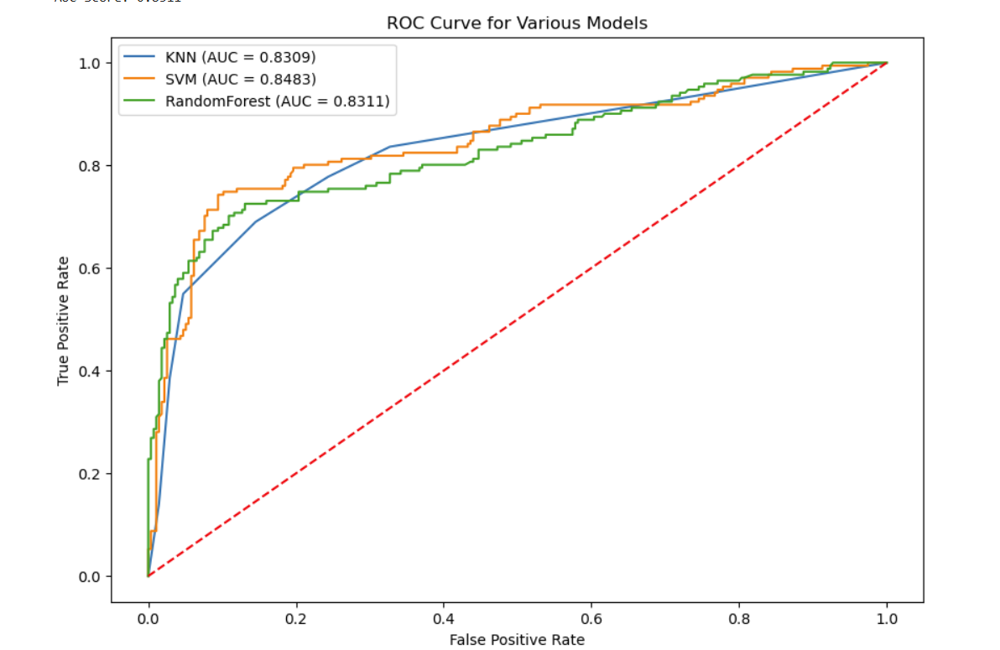

# data-science-portfolio
A collection of projects completed during my MS in Data Science problem at JHU. Consists of Jupyter notebooks, Python scripts, and reports. 

## Titanic Survival Predictions with Machine Learning
## Overview
Using a csv file for the titanic survival dataset [Kaggle](https://www.kaggle.com/datasets/yasserh/titanic-dataset), I was trying to predict which passengers would have survived the disaster based on different predictor variables such as class, sex, and age.

## Tools and Technologies

For this project, I used Python within a Jupyter Notebook with Pandas, Numpy, Scikit-Learn and Matplotlib libraries.

## Methodology

I was able to create 3 separate supervised machine learning models (K-Nearest Neighbors, Support Vector Machine, Random Forest) using this dataset. The data was split into training and test sets, and some exploratory data analysis was performed in order to determine the best predictor variables using a combination of bar charts, histograms, and first order statistics. 

Name, for example, was not a great predictor since each passenger had a unique one, and is somewhat arbitrary. On the other hand, although 65% of the passengers were men, only 20% of the male population survived, and when compared to the roughly 75% survival rate in women onboard, sex was a much stronger predictor variable to use in these models.

Then, missing data was handled using median imputation due to the minute amount of missing data, and feature processing was performed in order to scale each feature appropriately. Following that was model development, hyperparameter optimization, and finally model performance evaluation.

## Results

Below is a final output report for some machine learning models as part of a Titanic Survival Prediction dataset.

### Model Performance

| Model | Accuracy | F1 Score |
|-------|----------|----------|
| K-Nearest Neighbors | 79% | 0.79 |
| Support Vector Machine | 84% | 0.84 |
| Random Forest | 81% | 0.81 |

### Model Performance Results Visualization

### Conclusion

All models performed in a similar manner for this dataset, but the Support Vector Machine model achieved a slightly higher accuracy
and F1 score among the evaluated models.
